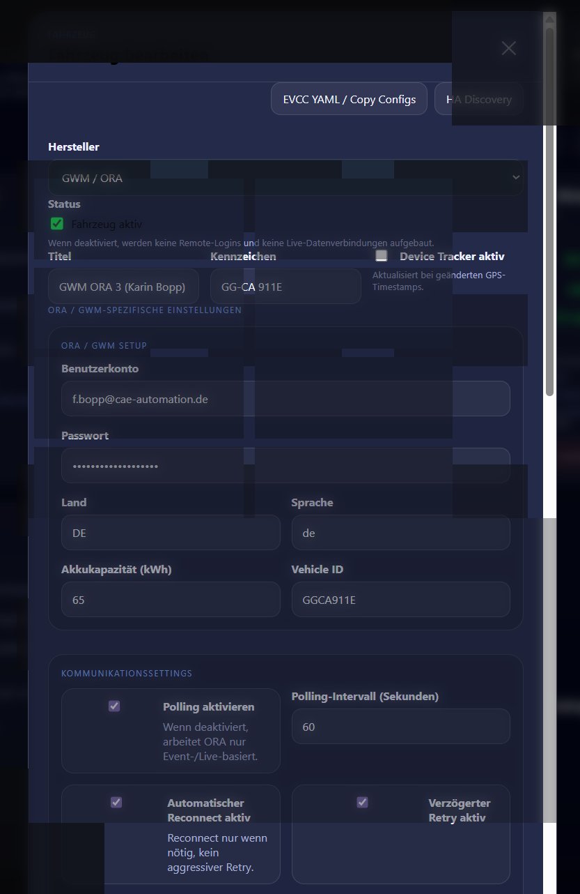

# Car2MQTT

**Car2MQTT** is a Home Assistant app for bringing vehicle data from **BMW CarData**, **GWM / ORA** and **ACCIONA / Silence (MySilence)** into MQTT, Home Assistant and EVCC.

It normalizes different manufacturer data into a common MQTT schema, can publish Home Assistant entities via MQTT Discovery, forwards vehicle data to additional MQTT brokers and supports distributed / multi-site EVCC setups.

> Current version: **1.2.65**

## Installation

### Requirements

- Home Assistant OS or another Home Assistant installation with App / Supervisor support
- an MQTT broker reachable by Car2MQTT
- valid access / credentials for the selected vehicle provider

### Add the Car2MQTT repository to Home Assistant

1. Open **Settings → Apps → App store** in Home Assistant.
2. Open the **⋮** menu in the upper-right corner and choose **Repositories**.
3. Add this repository URL:

```text
https://github.com/fbo1982/car2mqtt
```

4. Save the repository and refresh the App store if necessary.
5. Open **Car2MQTT** and choose **Install**.
6. Start Car2MQTT and open its web interface.
7. Configure the local MQTT broker first, then add your vehicles.

> Home Assistant previously called Apps “Add-ons”. Older Home Assistant versions or screenshots may still use the old wording.

## Supported vehicle sources

| Source | Integration | Status |
|---|---|---|
| BMW CarData (EU Data Act) | native streaming integration | ✅ tested in production use |
| GWM / ORA | integrated `ora2mqtt`-based runtime | ✅ tested in production use |
| ACCIONA / Silence / MySilence | native read-only cloud polling | ✅ tested in production use |
| Remote MQTT vehicles | generic normalized MQTT source | ✅ supported |

Car2MQTT is a community project and is **not affiliated with or endorsed by BMW, GWM, ORA, ACCIONA, Silence, Home Assistant or EVCC**. Undocumented manufacturer APIs can change without notice.

## Highlights

- Home Assistant app with web interface
- multi-vehicle and multi-manufacturer support
- normalized `mapped` MQTT schema
- Home Assistant MQTT Discovery
- optional MQTT Device Tracker
- local and remote MQTT brokers
- automatic Remote Vehicle detection
- EVCC vehicle configuration / Copy Helper
- site-local EVCC Geo Detection (`A` / `B` / `C`)
- Geo-Shelly automation for switchable charging sockets
- live logs and ReAuth / reconnect helpers
- persistent GWM / ORA rotating-token handling

## Quick start

After installing the app:

1. Open **Settings** in Car2MQTT and configure the local MQTT connection.
2. Optionally enable **Home Assistant MQTT Discovery**.
3. Add a vehicle and select its manufacturer / provider.
4. Save the vehicle and complete authentication if required.
5. Verify incoming values in the vehicle tile or Live Log.
6. Open the vehicle Copy Helper if you want to connect it to EVCC.

## How Car2MQTT works

Car2MQTT processes vehicle data in several layers:

1. Fetch or receive manufacturer data.
2. Keep the original provider data available as raw MQTT data where supported.
3. Normalize useful values into a common `mapped` schema.
4. Publish values to the local MQTT broker.
5. Optionally forward the vehicle to additional MQTT brokers.
6. Re-import normalized vehicles on other Car2MQTT installations as Remote Vehicles.
7. Generate Home Assistant and EVCC helpers from the normalized data.

Typical normalized topics:

```text
car/<manufacturer>/<plate>/mapped/soc
car/<manufacturer>/<plate>/mapped/range
car/<manufacturer>/<plate>/mapped/charging
car/<manufacturer>/<plate>/mapped/plugged
car/<manufacturer>/<plate>/mapped/odometer
car/<manufacturer>/<plate>/mapped/vehicleType
```

Additional metadata lives below:

```text
car/<manufacturer>/<plate>/_meta/...
```

## Vehicle types

Car2MQTT normalizes the powertrain so the UI and downstream consumers only receive values that make sense for the vehicle.

### Electric vehicle (BEV)

- State of Charge
- electric range
- charging / plugged state
- odometer
- charge limit where available
- no fuel metrics

### Plug-in hybrid / hybrid

- State of Charge / electric range
- fuel level / fuel range where supplied
- charging / plugged state
- odometer
- charge limit where available

### Combustion vehicle

- fuel level
- fuel range
- odometer
- powertrain information
- no traction-battery charging metrics

### BMW classification fix in 1.2.65

BMW CarData can expose generic battery-management and remaining-range datapoints on vehicles where those values do **not** indicate a plug-in hybrid or a fuel system. Version 1.2.65 therefore uses stronger drivetrain signals for classification and actively removes stale retained MQTT topics that contradict the detected powertrain.

This prevents, for example:

- a combustion BMW being shown as Hybrid because of 48-V battery information
- a pure BMW EV receiving a fuel / tank range from a generic remaining-range datapoint
- old retained MQTT values surviving after the classification has been corrected

## Home Assistant MQTT Discovery

Car2MQTT can publish Home Assistant entities for local vehicles via MQTT Discovery.

Enable it under **Settings → Home Assistant → MQTT Discovery**. Discovery data is then republished when Car2MQTT starts and when relevant vehicle settings change.

Depending on the provider, entities can include:

- State of Charge
- range
- odometer
- charging state
- plugged state
- charge limit
- battery capacity
- latitude / longitude
- vehicle metadata

The optional Device Tracker is configured separately.

### Migrating from manual MQTT sensors

If you previously created Car2MQTT sensors manually in `configuration.yaml`, remove duplicate manual entities before enabling Discovery. Existing Car2MQTT entity IDs are intentionally kept stable where possible so existing automations do not need unnecessary changes.

## GWM / ORA

The GWM / ORA integration is built on the technical foundation of **zivillian/ora2mqtt** and has been integrated and extended for Car2MQTT.

Car2MQTT manages the normal `ora2mqtt configure` / `run` lifecycle itself, including:

- authentication workflow
- one-time email / SMS code handling where required
- per-vehicle runtime configuration
- MQTT integration
- ReAuth / reconnect handling
- persistence of rotating access and refresh tokens

The adapted upstream source is kept under `car2mqtt/third_party/ora2mqtt/`. See [Third-party notices](THIRD_PARTY_NOTICES.md).

## ACCIONA / Silence / MySilence

The MySilence integration performs read-only cloud polling with the user's MySilence credentials.

Depending on the vehicle / backend response it can provide:

- State of Charge
- remaining range
- GPS position
- charging / connection state
- vehicle identification

A fixed vehicle can optionally be selected by FrameNo, IMEI or name. The polling interval is configurable; the default is 60 seconds.

Because the MySilence interface is not publicly documented, backend or app changes may require future adjustments.

### EVCC behavior

MySilence vehicles use `phases: 1` in generated EVCC examples and do not invent a `limitsoc` value when the backend does not provide one.

If a dedicated connection datapoint (`plugged`, `connected`, `chargerConnected` or `chargingConnected`) exists, it takes precedence over the generic charging flag.

## EVCC integration

Each vehicle can expose a directly copyable EVCC configuration from the Car2MQTT UI.

Car2MQTT can also generate helper blocks for:

- EVCC vehicle configuration
- Home Assistant `configuration.yaml`
- Home Assistant `automations.yaml`
- vehicle-selection / charging variables

### EVCC Geo Detection

For each vehicle, a Car2MQTT installation can calculate a **site-local** EVCC state on its own MQTT broker:

```text
car/<manufacturer>/<plate>/mapped/evccStatus
car/<manufacturer>/<plate>/mapped/evccAtSite
car/<manufacturer>/<plate>/mapped/evccDistance
car/<manufacturer>/<plate>/mapped/evccGeoReason
```

`evccStatus` uses EVCC's vehicle states:

- `A` — not connected at this site
- `B` — connected at this site
- `C` — charging at this site

When Geo Detection is enabled, `B` and `C` are only emitted if the current vehicle position is inside the configured radius around the selected Home Assistant zone. Missing zone or GPS data intentionally falls back to `A`.

The original manufacturer values in `mapped/plugged` and `mapped/charging` are **not modified**. This allows the same Remote Vehicle to be `A` at one location and `B` / `C` at another location.

Enable this under **Settings → EVCC → Standortabhängige Fahrzeugerkennung**.

### Home Assistant zone resolution

Car2MQTT resolves the selected zone through the Home Assistant API. `zone.home` has an additional fallback to Home Assistant system coordinates, and custom zones have a template-based fallback. Zone resolver errors are surfaced instead of being silently ignored.

### EVCC charge limit

`limitSoc` is treated as a long-lived setting. Generated EVCC configurations therefore do not apply an artificial MQTT timeout to `limitsoc`. Live values such as SoC, range and `evccStatus` keep their timeout so a failed vehicle data source remains visible.

## Geo-Shelly automation

Car2MQTT can switch a Shelly-controlled charging socket on once when one of the selected vehicles arrives and switch it off again after a real departure.

Each local or Remote Vehicle can independently be enabled as a trigger using **“Geo-Shelly an diesem Standort auslösen”**. This selection is stored locally for Remote Vehicles, so the same vehicle can trigger one site but not another.

Site-specific Shelly settings are configured under **Settings → Geo Automation**:

- Shelly host / IP
- Shelly Switch ID
- maximum power allowed for safe switch-off

For a Shelly Pro 1PM the Switch ID is usually `0`, corresponding to the Shelly RPC channel `Switch:0`.

## Remote MQTT / distributed setups

Car2MQTT can forward vehicle data to additional MQTT brokers. A second Car2MQTT installation can automatically recognize those normalized topics and display the vehicle as **REMOTE**.

This makes setups possible where:

- one central installation authenticates against the vehicle manufacturer
- several Home Assistant sites consume the same vehicle data
- local and Remote Vehicles are displayed together
- each site calculates its own EVCC Geo state
- vehicle authentication does not need to be duplicated at every location

Remote forwarding can be limited to normalized `mapped` values or include raw values where appropriate.

## MQTT structure

Typical topic layout:

```text
car/<manufacturer>/<plate>/_meta/...
car/<manufacturer>/<plate>/mapped/...
car/<manufacturer>/<plate>/...
```

Examples:

```text
car/bmw/GGCA501E/mapped/soc
car/gwm/GGCA911E/mapped/range
car/acconia/SIL123/mapped/soc
car/acconia/SIL123/mapped/latitude
car/acconia/SIL123/mapped/longitude
car/bmw/GGCA1056/_meta/last_update
```

## Web interface

### Vehicles

- add and edit local vehicles
- select provider / manufacturer
- maintain provider-specific credentials and parameters
- assign forwarding MQTT clients
- enable the optional Device Tracker
- configure local Geo-Shelly trigger behavior

### Settings

- local MQTT configuration
- Home Assistant zone selection
- MQTT Discovery settings
- Device Tracker settings
- EVCC Geo Detection
- Geo Automation / Shelly settings

### MQTT clients

- define additional MQTT destinations
- enable / disable destinations
- forward only `mapped` or also raw values
- inspect connection state

### Copy Helper

- EVCC vehicle snippets
- Home Assistant MQTT / automation snippets
- vehicle-specific helper blocks

## Screenshots

The screenshots in the repository are redacted to hide license plates, names, hosts, logins and similar sensitive data.

### Dashboard / UI example 1



### Dashboard / UI example 2


## Updating

When a new Car2MQTT version is published, Home Assistant should offer the update through the App page after the repository metadata has refreshed.

The app version is defined in `car2mqtt/config.yaml` and mirrored in `car2mqtt/VERSION`. Regression tests verify that these version values stay synchronized.

See [CHANGELOG.md](CHANGELOG.md) for notable changes.

## Privacy and security

Vehicle integrations can handle sensitive information. Before publishing logs, screenshots or configuration snippets, review them for:

- usernames / email addresses
- passwords
- access and refresh tokens
- VINs / IMEIs
- license plates
- GPS coordinates
- MQTT credentials
- internal hostnames and IP addresses

Do not commit runtime-generated `ora2mqtt.yml` files or local provider state to Git.

## Project status

Car2MQTT is developed around practical Home Assistant, MQTT and EVCC workflows. BMW, GWM / ORA and ACCIONA / Silence are the currently verified native integrations. Other vehicle sources can be added through the provider / mapping structure or consumed as normalized Remote Vehicles.

Issues and reproducible logs are welcome, but please remove personal and authentication data before posting them publicly.

## Third-party code and licensing

The GWM / ORA part includes modified source originating from **zivillian/ora2mqtt**. Attribution and details are documented in [THIRD_PARTY_NOTICES.md](THIRD_PARTY_NOTICES.md).

At the time of publication, the upstream `zivillian/ora2mqtt` repository did not contain an explicit license file. For that reason, Car2MQTT does **not** claim to relicense that third-party code under a different license.

A project-wide open-source license should only be added after the rights for the included third-party code have been clarified or the third-party directory has been replaced with code whose license is compatible with the chosen Car2MQTT license.

## Development and tests

The regression suite can be run locally with:

```bash
cd car2mqtt
python -m pip install -r requirements.txt
python -m pip install pytest
pytest -q
```

The repository also contains a GitHub Actions workflow that runs the test suite for pushes and pull requests against `main`.
